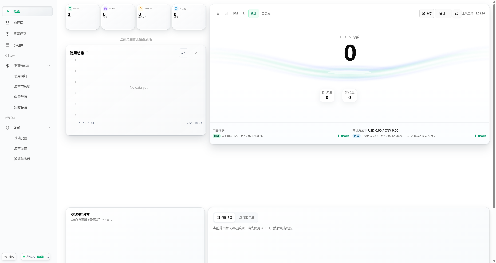

# Token Eyes

本地优先的 AI 编程工具用量查看器。把分散的 Token 用量、费用估算和会话信息放到一个 Windows 桌面界面中。

**社区预览版 · 开源共创中**。项目仍有已知问题，欢迎真实使用、反馈、补文档和提交 PR。当前下载不代表稳定版或完整验收通过。

[下载 Windows x64 安装包](https://github.com/muxunson-9677/token-eyes/releases/download/v0.54.50/Token-Eyes-0.54.50-Windows-x64-setup.exe) · [发布说明与 SHA256](https://github.com/muxunson-9677/token-eyes/releases/tag/v0.54.50) · [反馈问题](https://github.com/muxunson-9677/token-eyes/issues/new/choose) · [交流讨论](https://github.com/muxunson-9677/token-eyes/discussions) · [参与贡献](CONTRIBUTING.md)

## 能用它做什么

- 在概览中查看本机 AI 编程工具的 Token 用量与趋势。
- 在使用明细中按来源、模型查看请求级统计，在实时会话中查看会话用量状态。
- 查看费用估算，辅助理解用量；估算不等同于供应商实际账单。

各来源是否有数据取决于本机工具、日志和授权状态，支持入口存在不代表每种环境都已验证。

## 界面预览



截图来自公开 `v0.54.50` 安装包的原生窗口，使用隔离测试资料，展示空数据状态；不包含真实账号或个人用量。[截图来源及验证边界](docs/getting-started.md#截图与验证范围)。

## 下载与使用

下载页请选名称包含 `Windows-x64-setup.exe` 的附件；`Source code` 是开发者源码，不是安装包。完整步骤见[首次使用、SHA256 校验与常见问题](docs/getting-started.md)。

1. Windows 10/11 x64 用户下载上方的 `setup.exe`，运行安装后打开 Token Eyes。无需自行安装 Node.js 或 Rust。
2. 安装包未做 Authenticode 签名，Windows 可能显示“未知发布者”或 SmartScreen 提示。请确认下载来源与本仓库一致；校验和见 Release 附件。受组织策略限制的设备请联系管理员。
3. 在本机已有 AI 工具用量记录的情况下查看数据；没有记录、未配置或未授权的数据源可能为空。本地查看无需注册 Token Eyes 云账号。
4. 遇到异常，请在本仓库提交 Issue，附版本、复现步骤和脱敏截图。请勿上传密钥、Cookie、完整对话或私人日志。

本轮仅提供 Windows x64 社区预览。macOS/Linux 源码仍保留，但不承诺本次首发的可用性或功能一致性。卸载可通过 Windows“已安装的应用”进行；个人数据是否保留请自行备份确认。

## 这个预览包的边界

- 当前版本为 `0.54.50`，Windows x64、未签名；构建对应的 main SHA、SHA256 和实际检查范围见 Release 附件。历史 `0.54.49` 预览仍保留。
- every-code 日志原地等长改写时可能重复统计用量，Claude 同情形可能重复会话计数；费用为估算，不应作为账单凭证。
- 本地 HTTP 接口的来源限制仍需加强。运行时不要把本地端口暴露到公网；不需要时退出应用，并避免在运行期间访问不可信网页。
- 排行榜、公告等在线功能依赖第三方免费服务，可能不可用或过期，不保证持续更新。
- 历史 `0.54.49` 安装包内部分帮助或下载链接可能仍指向上游项目。更新和反馈统一使用本 README 的链接。
- 六个采集与界面修复提交及审查补丁已通过 [PR #28](https://github.com/muxunson-9677/token-eyes/pull/28) 合入 main。完整 Node 测试仍有 3 项可在旧 main 复现的失败；未完成全功能、真实供应商账号与三平台验收。已知问题将通过 Issue / PR 持续处理。

首发历史见 [0.54.49 社区预览记录](docs/community-preview.md)；本轮范围和证据见 [执行合同](docs/superpowers/plans/2026-10-22-community-preview-main-release.md)及[执行状态](docs/superpowers/plans/2026-10-22-community-preview-main-release-status.md)。

## 一起完善

不需要先理解整个项目。可以从复现问题、补充安装说明、修正文案或增加脱敏测试开始。

- [适合首次贡献的问题](https://github.com/muxunson-9677/token-eyes/issues?q=is%3Aissue%20is%3Aopen%20label%3A%22good%20first%20issue%22)
- [需要帮助的问题](https://github.com/muxunson-9677/token-eyes/issues?q=is%3Aissue%20is%3Aopen%20label%3A%22help%20wanted%22)
- [贡献指南](CONTRIBUTING.md) / [提交 PR](https://github.com/muxunson-9677/token-eyes/compare)
- 安全问题请使用 [私密漏洞报告](https://github.com/muxunson-9677/token-eyes/security/advisories/new)，不要公开真实凭据或利用数据。

## 本地开发

```bash
git clone https://github.com/muxunson-9677/token-eyes.git
cd token-eyes
npm ci
npm --prefix dashboard ci
npm run dashboard:dev
```

开发建议使用 Node.js 24。`dashboard:dev` 使用开发模拟接口；验证真实采集需启动本地 CLI。Windows Tauri 开发还需要 Rust、C++ Build Tools 和 WebView2，详见 [贡献指南](CONTRIBUTING.md)。

## 开源许可与致谢

采用 [MIT License](LICENSE)。本项目基于 [TokenTracker](https://github.com/mm7894215/TokenTracker) 演进，仓库也保留了 [CC Switch](https://github.com/farion1231/cc-switch) 的相关代码和资料；感谢原作者及贡献者。原有版权与许可声明继续保留，项目名称和下载入口统一使用 Token Eyes。
