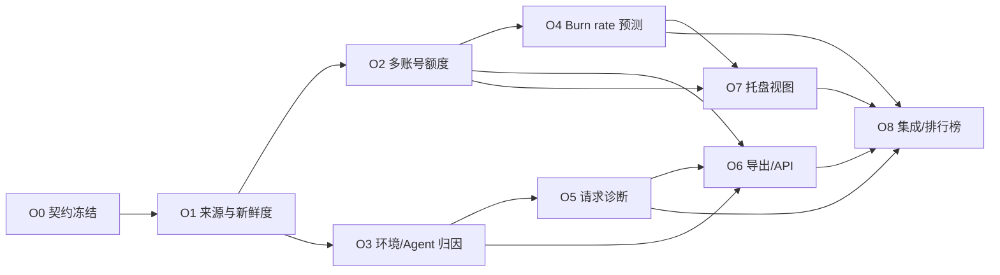

# Token Eyes Token 用量项目优化多阶段开发文档

> 用途：在《代码问题修复执行文档》全部完成后，把本文件按工作包交给多个独立编码对话执行。
>
> 执行者：任意编码 Agent；不绑定 Codex、Cursor、Trae 或其他工具。
>
> 范围：只借鉴 Token 用量、额度和观测能力，不实现模型切换、账号切换、Provider 切换、代理、MCP 或 Skill 管理。

## 一、最终产品目标

在 Token Eyes 已有本地 Token 采集、成本、套餐额度、请求记录和排行榜基础上，增加七项高价值能力：

1. 多账号额度矩阵：同一 Provider 的多个账号并排观察，只读，不切换。
2. 多环境/多 Agent 归因：知道哪台机器、哪个环境、哪个 Agent、哪个项目消耗了额度。
3. 额度燃烧速度与耗尽预测：显示当前速度、是否超前消耗、预计何时耗尽。
4. 数据来源、置信度和新鲜度：每个数字说明来自哪里、是否精确、何时更新、是否过期。
5. 紧凑常驻视图：托盘/菜单栏直接看到 5h、7d、月度窗口和重置倒计时。
6. JSON/CSV 导出与安全本地只读 API：便于用户自行分析，同时严格限制 loopback、Host 和 CORS。
7. 请求级诊断：成功状态、延迟、首 Token 延迟、缓存命中和定价依据。

优化完成后的产品定位：

> 不切账号、不切模型、不做代理，只把所有 AI Agent 的 Token、额度、成本和消耗来源看清楚。

## 二、前置条件

不得在代码修复工作尚未完成时开始本计划。

开始 O0 前必须确认：

- 本地 API 已有严格 Host、Origin、CORS 和本地认证。
- 测试不会读取真实 HOME 或访问真实供应商。
- Node、Dashboard、TypeScript、Lint、有效 Rust 和生产构建门禁可信。
- Provider 能力注册表已经统一。
- Token strict 审计可用。
- 当前工作区无未知来源的未提交冲突。

任何一项不满足，都返回修复文档对应阶段，不在优化阶段重复修底座。

## 三、已确认的排行榜范围

排行榜是 Token Eyes 的现有核心功能，不得再从完整功能说明中遗漏。

当前代码已有：

- 周榜、月榜、总榜；
- 用户排名、参与人数和当前用户定位；
- Provider Token 列；
- 分页和每页数量；
- Provider 列拖动排序和本地保存；
- 公开个人资料页；
- 排行规则、登录参与、资料和分享相关基础能力；
- 排行榜预加载和缓存。

当前仍是占位或未正式开放的部分：

- 今日/昨日；
- 去缓存 Token 口径；
- 预估费用排行；
- Agent 分榜；
- `App.jsx` 当前把排行榜及个人页归入 MVP 隐藏路由。

本优化采用已经确认的保守范围：

1. 恢复并验证已经完成的排行榜入口、周/月/总榜和个人页。
2. 让七项优化产生的聚合数据可以在隐私允许时与排行榜联动。
3. 环境、项目、会话、真实账号 ID 默认只留本地，不上传排行榜。
4. 不把所有排行榜占位项作为“第八项功能”强行补完。
5. 某个占位项只有在七项优化自然提供可靠数据且不扩大隐私范围时才可启用。

## 四、参考项目与具体借鉴点

| 项目 | 借鉴内容 | 明确不借鉴 |
|---|---|---|
| [Cockpit Tools](https://github.com/jlcodes99/cockpit-tools) | 同一 Provider 多账号额度并排、重置时间、错误与过期状态 | 账号切换、多实例 |
| [CC Switch](https://github.com/farion1231/cc-switch) | Agent/Provider/模型筛选联动，请求状态、延迟、Token 分项、成本 | Provider 切换、代理、MCP、Skill |
| [CodexBar](https://github.com/steipete/CodexBar) | 多账号、常驻额度、JSON、严格 loopback/Host/CORS | 账号切换 |
| [ccusage](https://github.com/ccusage/ccusage) | Agent、项目、session、模型分组及 JSON 输出 | 与 Token 无关的管理能力 |
| [Claude Code Usage Monitor](https://github.com/Maciek-roboblog/Claude-Code-Usage-Monitor) | Burn rate、Pace、预计耗尽、置信度和告警 | 把估算值冒充官方额度 |
| [Claude HUD](https://github.com/jarrodwatts/claude-hud) | 官方值优先、未知不显示为 0、快照新鲜度 | 工具活动和非 Token 功能 |
| [ccstatusline](https://github.com/sirmalloc/ccstatusline) | 极简/标准/完整三种额度显示密度 | 状态栏配置生态 |
| [Agent Sessions](https://github.com/jazzyalex/agent-sessions) | 多 Agent、项目、会话归因 | 会话正文展示 |
| [Helicone](https://github.com/Helicone/helicone) | 请求延迟、TTFT、成本依据和价格版本 | AI Gateway、Prompt 观测 |

## 五、不会因为第一阶段发现问题而推翻计划的结构

本计划把“未知事实”和“功能实现”分开：

1. O0 只做调查、特征测试和公共契约冻结。
2. O1 只实现所有功能共用的来源/新鲜度底座。
3. 后续七项能力只依赖版本化契约，不直接依赖其他对话的内部实现。
4. 公共契约变更必须增加版本，不允许静默改字段语义。
5. 每个工作包有独立文件边界、输入、输出、验收和回滚方式。
6. 并行工作包先在独立分支完成，由后续集成阶段按固定顺序合并。
7. 发现局部代码与预期不同，只调整适配器，不重写公共模型。

### 契约冻结规则

- `schema_version` 一旦进入 O2，不得直接改写。
- 新字段优先可选，旧数据必须仍可读取。
- `null` 表示未知或不可用，绝不能被转换成 `0`。
- 时间全部存 UTC ISO-8601；UI 再按本地时区显示。
- 百分比统一为 `0–100`。
- Token 数量使用安全整数或字符串传输，不能发生 JavaScript 精度丢失。
- 每个聚合结果必须能解释来源和覆盖范围。
- 账号、设备、项目和会话标识默认只在本地使用。

## 六、公共数据契约

O0 将下列契约写入正式开发说明和共享 fixture。字段名后续不得随意更换。

### 6.1 数据证据

```ts
type SourceKind =
  | "official_api"
  | "session_log"
  | "sqlite"
  | "hook"
  | "otel"
  | "cache"
  | "estimated"
  | "user_override";

type Accuracy = "exact" | "normalized" | "estimated" | "unknown";
type Coverage = "complete" | "partial" | "unavailable" | "unpriced";

interface DataEvidenceV1 {
  source_kind: SourceKind;
  accuracy: Accuracy;
  coverage: Coverage;
  observed_at: string;
  source_updated_at: string | null;
  stale_after_seconds: number;
  is_stale: boolean;
  pricing_source: string | null;
  pricing_version: string | null;
  note_code: string | null;
}
```

### 6.2 多账号额度

```ts
interface LimitWindowV2 {
  kind: "five_hour" | "seven_day" | "monthly" | "custom";
  label: string;
  used_percent: number | null;
  reset_at: string | null;
  window_seconds: number | null;
  evidence: DataEvidenceV1;
}

interface LimitAccountV2 {
  provider_id: string;
  account_key: string;
  account_label: string;
  plan_label: string | null;
  status: "ok" | "stale" | "unavailable" | "auth_error" | "rate_limited";
  windows: LimitWindowV2[];
  last_success_at: string | null;
  error_code: string | null;
}
```

`account_key` 是使用本机随机盐生成的稳定不可逆标识，不得是邮箱、真实账号 ID 或 Token。

### 6.3 使用量归因

```ts
interface UsageDimensionsV1 {
  device_id: string;
  environment_id: string;
  environment_kind: "native" | "wsl" | "ssh" | "container" | "unknown";
  agent_id: string;
  account_scope: string | null;
  project_key: string | null;
  session_key: string | null;
  model_id: string | null;
}
```

`session_key` 只进入请求级记录，不进入小时快照的去重主键；否则会破坏现有 bucket 聚合。

### 6.4 请求诊断

```ts
interface RequestDiagnosticV2 {
  request_id: string;
  timestamp: string;
  dimensions: UsageDimensionsV1;
  requested_model: string | null;
  response_model: string | null;
  pricing_model: string | null;
  input_tokens: number;
  output_tokens: number;
  cached_input_tokens: number;
  cache_creation_input_tokens: number;
  reasoning_output_tokens: number;
  success: boolean | null;
  status_code: number | null;
  latency_ms: number | null;
  first_token_ms: number | null;
  total_cost_usd: string | null;
  unpriced_tokens: number;
  evidence: DataEvidenceV1;
}
```

没有请求级数据的 Agent 只能返回聚合记录，并将 `success`、`latency_ms`、`first_token_ms` 设为 `null`，不能伪造为成功、0 ms 或 `$0.00`。

## 七、工作包和依赖关系

计划共九个对话：

- O0：准备与契约冻结；
- O1：来源、置信度和新鲜度；
- O2：多账号额度矩阵；
- O3：多环境/多 Agent 归因；
- O4：燃烧速度与耗尽预测；
- O5：请求级诊断；
- O6：JSON/CSV 与安全本地 API；
- O7：托盘/菜单栏紧凑视图；
- O8：集成、排行榜和最终验收。



### 可以并行的批次

| 批次 | 可并行工作包 | 条件 |
|---|---|---|
| 第一批 | O2 与 O3 | O1 已合并，公共契约未改变 |
| 第二批 | O4 与 O5 | O2、O3 已分别完成；两者不改对方模块 |
| 第三批 | O6 与 O7 | O4、O5 已完成；严格遵守文件所有权 |

O0、O1、O8 必须串行。

### 为什么不让七项全部并行

- 多账号、预测和托盘共用额度契约。
- 环境归因、请求诊断和导出共用维度与请求记录。
- 本地 API 是共享集成点。
- 在公共字段未冻结前并行，会出现同一个字段在不同分支被命名三次，最终只能推翻重做。

## 八、上下文分配

### 所有对话都必须读取

- `CLAUDE.md`
- 本文档
- `docs/dev-notes/token-observability-v2-contract.md`（由 O0 创建）
- 自己直接依赖阶段的交接报告

### 不应该共享整段聊天记录

不同 Agent 不需要继承其他对话的全部聊天历史。长对话会引入已过时假设。共享以下稳定产物即可：

- 已合并 commit SHA；
- 版本化数据契约；
- API fixture；
- 文件所有权；
- 自动与真实体验验收结果；
- 已知限制。

### 交接文件

每个工作包结束时创建：

```text
docs/test-reports/optimization/Ox-<工作包>-handoff.md
```

固定内容：

```text
起始 commit：
结束 commit：
实现范围：
未实现范围：
公共契约版本：
修改文件：
迁移：
测试命令与结果：
真实体验证据：
性能/安全结果：
已知限制：
下游注意事项：
回滚方式：
```

### 哪些对话共用上下文

| 工作包 | 必须继承 | 应保持独立 |
|---|---|---|
| O1 | O0 契约 | 不读取后续 UI 设想 |
| O2 | O0、O1 | 不读取 O3 内部实现 |
| O3 | O0、O1 | 不读取 O2 账号实现 |
| O4 | O0、O1、O2 handoff | 与请求诊断独立 |
| O5 | O0、O1、O3 handoff | 与额度预测独立 |
| O6 | O0、O1、O2/O3/O5 handoff | 不接管托盘 |
| O7 | O0、O1、O2/O4 handoff | 不接管导出/API |
| O8 | 全部 handoff，使用新鲜上下文 | 不继承任何一个实现对话的主观结论 |

## 九、公共文件所有权

并行阶段中，以下共享文件只能由指定集成阶段修改：

| 文件 | 规则 |
|---|---|
| `src/lib/local-api.js` | 功能 Agent只提供独立 service/handler；O6 或 O8 统一接线 |
| `dashboard/src/lib/api.ts` | O0 定义类型和入口；O6/O8 统一接线 |
| `dashboard/src/content/copy.csv` | 各分支可追加独立 key，O8 统一处理冲突 |
| `dashboard/src/App.jsx` | 只有 O8 修改排行榜路由和最终导航 |
| `package.json` | O0/O8 维护公共命令；其他阶段不随意改 |
| `src-tauri/src/lib.rs` | O7 或 O8 统一注册新桌面命令 |

功能 Agent 优先新增小型模块，不在 `local-api.js` 内继续堆积大量业务逻辑。

## 十、O0：准备、特征测试与契约冻结

### 目标

在任何功能实现前，证明当前接口行为，冻结字段、兼容策略、隐私范围和文件边界。

### 主要输出

- `docs/dev-notes/token-observability-v2-contract.md`
- `shared/schemas/token-observability-v2.schema.json`
- `test/fixtures/token-observability-v2/`
- Dashboard 对应 TypeScript 类型
- 旧 v1 到 v2 的兼容映射测试

### 任务

1. 记录当前 `usage-limits`、`request-usage-records`、queue 和 Provider 适配器响应。
2. 写 characterization tests，确保升级前已知行为被记录。
3. 最终确认第六节字段及枚举。
4. 定义旧数据缺少字段时的默认值：未知字段为 `null`/`unknown`，不能为 0。
5. 定义本地 ID 生成和盐存储方式。
6. 定义隐私红线：不保存 Prompt、回复正文、Cookie、API key、真实邮箱、完整敏感路径。
7. 定义小时 bucket 的新版维度 key，确保不会因 session 拆分造成重复累计。
8. 定义 feature-level API fixture，让各并行 Agent 对同一输入输出开发。

### 验收

- Schema 可由自动测试校验。
- v1 fixture 能无损转换成 v2 的已知部分。
- v2 再次聚合不会改变 Token 总量。
- 所有“不知道”的值保持 `null` 或 `unknown`。
- O2–O7 不需要修改字段名即可开始工作。

### 失败处理

如果某 Provider 无法提供某字段，修改其 `coverage`，不修改公共字段。

## 十一、O1：数据来源、置信度和新鲜度

对应高价值建议 4。

### 用户结果

每个额度、Token、成本和诊断数字都能回答：

- 数据来自官方 API、日志、SQLite、Hook、OTEL、缓存还是估算；
- 是精确、归一化还是估算；
- 最后何时读取；
- 原始来源何时更新；
- 是否过期；
- 成本使用哪份价格和版本；
- 覆盖是完整、部分还是未定价。

### 建议模块

- `src/lib/data-evidence.js`
- `src/lib/data-freshness.js`
- `src/lib/pricing/` 中增加价格来源元数据
- Dashboard 新增统一 Evidence badge/tooltip

### 任务

1. 用固定时钟测试 stale 边界。
2. 实现 `DataEvidenceV1` 规范化和校验。
3. 给官方额度、缓存额度、本地日志、请求记录和价格结果加 Evidence。
4. 旧接口继续返回原字段，同时附加 `evidence`。
5. Dashboard 对“官方”“本地精确”“本地归一”“估算”“缓存”“部分未定价”使用统一组件。
6. stale 时保留最后成功值，降低视觉强调并显示更新时间；不得直接清零。
7. 未定价 Token 显示未知或部分覆盖，不显示 `$0.00`。

### 测试重点

- 时钟恰好跨过 `stale_after_seconds`。
- 官方请求失败但存在最后成功缓存。
- 只有部分模型定价。
- 旧响应没有 Evidence。
- `source_updated_at` 晚于/早于 `observed_at` 的异常输入。

### 真实体验

- 断网打开应用，额度显示最后值和“已过期”，不闪成 0。
- 有未定价模型时，成本显示“部分”，总 Token 不丢失。
- Tooltip 文案能让小白理解“官方值”和“本地估算”的区别。

### 下游契约

O2–O7 只能复用这里的 Evidence，不得各自定义 `fresh`、`cached`、`confidence` 字段。

## 十二、O2：多账号额度矩阵

对应高价值建议 1。

### 用户结果

同一 Provider 下多个已授权账号并排展示：

- 账号别名；
- 套餐；
- 5h/7d/月度或 Provider 自定义窗口；
- 已用/剩余显示切换；
- 重置倒计时；
- 最后更新时间；
- 正常、过期、认证失败、限流和不可用状态。

只观察，不提供“设为当前账号”、切换、导入其他工具账号或多开实例。

### 实施前能力调查

为每个 Provider 建立真实能力表：

| 能力 | 判断 |
|---|---|
| Token Eyes 是否已保存多个授权绑定 | 是/否 |
| 是否能逐账号只读查询额度 | 是/否 |
| 查询是否会改变当前账号 | 必须为否 |
| 是否有真实多账号验证环境 | 是/否 |

没有真实验证的 Provider 不得标记为正式支持多账号。

### 建议模块

- `src/lib/limit-accounts.js`
- `src/lib/limit-account-adapters/<provider>.js`
- `dashboard/src/hooks/use-limit-accounts.ts`
- `dashboard/src/ui/dashboard/components/LimitAccountMatrix.jsx`

### 任务

1. 从 Token Eyes 自己已经授权的账号绑定枚举账号；不读取独立账号切换器的数据。
2. 用本机盐将真实账号 ID 映射为 `account_key`。
3. 支持账号别名；日志中只出现别名或短 hash。
4. 单 Provider 使用 single-flight，跨 Provider 最大并发建议 3。
5. 失败账号不影响其他账号；保留最后成功快照。
6. 首先兼容单账号返回，随后再启用多账号矩阵。
7. Limits 页面提供 Provider 分组和账号行。
8. 没有额度窗口时显示“额度不可用”，不显示红色 0%。

### 测试重点

- 同 Provider 两账号不同窗口。
- 一个成功、一个认证失败。
- 重复点击刷新只产生一次同账号请求。
- 账号删除后历史快照不泄漏真实 ID。
- 返回顺序变化时 UI 仍按稳定 `account_key` 保持顺序。
- 单账号 Provider 不出现空的“第二账号”占位。

### 真实体验门

正式宣称某 Provider 支持多账号前，必须用两个测试账号完成只读刷新；如果无真实条件，只能标为实验性，并明确说明 fixture 通过但尚未真实验证。

## 十三、O3：多环境/多 Agent/项目归因

对应高价值建议 2。

### 用户结果

用户可以回答：

- 哪台设备消耗最多；
- Windows、WSL、SSH 或容器中哪个环境消耗最多；
- 哪个 Agent 消耗最多；
- 哪个项目和模型消耗最多；
- 当前官方额度变化中，有多少能被本地观察到；
- 有多少消耗无法归因。

### 隐私边界

- 设备 ID、环境 ID、项目和 session 默认只存本地。
- 项目显示名默认使用目录末级或用户别名，不显示完整路径。
- 排行榜不上传环境、项目、session 和真实账号。
- 云同步如需 Agent 聚合，必须单独明确同意并只上传汇总。

### 建议模块

- `src/lib/usage-dimensions.js`
- `src/lib/usage-dimension-key.js`
- `src/lib/environment-detector.js`
- `dashboard/src/hooks/use-usage-attribution.ts`
- `dashboard/src/ui/dashboard/components/UsageAttributionMatrix.jsx`

### 任务

1. 复用现有 `tokentracker-agent-environment` 能力，统一 native/WSL/SSH/container。
2. 为新数据写入可选维度，不破坏旧 queue。
3. 小时快照去重 key 只包含适合聚合的维度；session 只保留在请求级记录。
4. 为旧数据建立 `unknown` 环境桶，不猜测历史环境。
5. API 支持 device/environment/agent/project/model 分组和筛选。
6. Dashboard 顶部总览、趋势和下方表格使用同一过滤条件。
7. 显示“未归因”差值：官方额度变化减去本地可观察贡献；该值必须标注为估算。

### 不变量

```text
已归因 Token + 未归因 Token = 当前筛选总 Token
各 Agent 之和 = 当前环境总量
各环境之和 = 当前设备总量
```

Token 数量不允许四舍五入容差。

### 测试重点

- 同一小时两个环境不能互相覆盖。
- 同一 session 多次增量不会重复累计。
- 旧数据全部进入 `unknown`，总量不变。
- 项目缺失、路径变化、WSL UNC 路径。
- 过滤器组合后总览、图表、表格一致。

### 真实体验

至少用本机两个可区分环境或 fixture + 一个真实环境验证；切换筛选后所有视图同时变化，不能只有表格变化。

## 十四、O4：额度燃烧速度与耗尽预测

对应高价值建议 3。

### 用户结果

每个账号额度窗口显示：

- 已用百分比；
- 时间已经过去的百分比；
- Pace ratio；
- 最近 15/30/60 分钟 Burn rate；
- 按当前速度预计耗尽时间；
- 是否会在重置前耗尽；
- 样本数和置信度；
- 建议状态：正常、注意、危险、数据不足。

### 数据来源

预测优先使用同一账号、同一额度窗口的官方 `used_percent` 时间序列。不能用不同账号、不同 reset 周期或本地 Token 生搬硬套。

建议新增本地、隐私安全的额度样本历史：

```text
~/.tokentracker/quota-samples.jsonl
```

只保存 account hash、窗口、百分比、reset_at、时间和 Evidence；不保存凭据。

### 算法最低要求

- 至少 3 个有效样本；
- 样本时间跨度至少 10 分钟；
- reset_at 变化或 used_percent 明显回落时开始新周期；
- 忽略乱序、重复和 stale 样本；
- 使用稳健斜率，避免单点尖峰支配结果；
- 输出点估计和范围，不只输出一个绝对时间；
- 预测晚于 reset 时显示“按当前速度不会在本周期耗尽”；
- 数据不足时只显示现状，不给预测。

### Pace

```text
time_elapsed_percent = 已经过时间 / 窗口总时长
pace_ratio = used_percent / time_elapsed_percent
```

窗口开始时间不能确定时，不显示 Pace，不能凭 reset_at 强行反推滑动窗口。

### 建议模块

- `src/lib/quota-history.js`
- `src/lib/quota-forecast.js`
- `dashboard/src/ui/dashboard/components/LimitPaceIndicator.jsx`

### 测试重点

- 匀速、加速、停止消耗。
- reset、滑动 reset_at、跨时区显示。
- stale、乱序、重复样本。
- 百分比抖动和 Provider 修正历史值。
- 预测恰好早于/晚于 reset。
- 应用重启后历史仍正确。

### 真实体验

使用可控时钟回放一整段窗口；UI 的已用、时间进度、Pace、预测、置信度和 reset 必须相互一致。不得把“预计”写成“官方”。

## 十五、O5：请求级诊断

对应高价值建议 7。

### 用户结果

当数据源确实提供请求粒度时，每条记录显示：

- 成功/失败/未知；
- 状态码；
- 总延迟；
- 首 Token 延迟；
- 输入、输出、缓存读、缓存写、推理 Token；
- 请求模型、响应模型、计价模型；
- 成本；
- 定价来源、版本和未定价 Token；
- Agent、环境、项目和 session 归因。

### 现有基础

项目已有 `RequestUsageLog.jsx`、`use-request-usage-records.ts`，以及 latency、first token、status、cache 和 cost 的部分字段。本阶段应规范化现有能力，不另建代理或网关。

### 建议模块

- `src/lib/request-diagnostics.js`
- `src/lib/request-diagnostic-adapters/<source>.js`
- `dashboard/src/ui/dashboard/components/RequestDiagnosticDetails.jsx`

### 任务

1. 对每种来源声明请求级覆盖能力。
2. 将原始字段映射到 `RequestDiagnosticV2`。
3. 区分 requested/response/pricing model。
4. 统一 cache read/write 和 cache hit 计算口径。
5. 未知成功率、延迟和成本保持 `null`。
6. 请求表、Provider 汇总、模型汇总共用同一筛选范围。
7. 错误信息只保留安全分类，不展示 Prompt、回复、Token、Cookie 或完整敏感 URL。
8. 大量记录使用分页或虚拟化，避免一次加载全部。

### 测试重点

- 成功、失败、未知。
- streaming TTFT 与总延迟。
- 有缓存读无缓存写、反之亦然。
- 模型别名和路由后模型变化。
- 未定价模型。
- 只有聚合日志、没有请求日志。
- 相同 request ID 去重。

### 真实体验

选择一条可提供请求明细的 Agent 运行成功请求和失败请求；界面状态与原始脱敏日志一致。没有数据的 Agent 应明确显示“该来源不提供请求级数据”。

## 十六、O6：JSON/CSV 导出与安全本地只读 API

对应高价值建议 6。

### 前置

必须继承修复阶段的本地认证、Host、Origin 和 CORS 契约。不得为了“方便外部分析”重新开放 `Access-Control-Allow-Origin: *`。

### 建议 API

```text
GET /api/v2/limits
GET /api/v2/usage
GET /api/v2/requests
GET /api/v2/export?dataset=usage&format=json
GET /api/v2/export?dataset=requests&format=csv
```

所有响应带：

- `schema_version`；
- `generated_at`；
- 当前过滤条件；
- Evidence/coverage；
- 分页信息；
- 脱敏说明。

### 安全要求

- 服务只绑定 loopback。
- Host 严格白名单。
- 浏览器 Origin 严格白名单，不开放通配 CORS。
- 全部数据接口要求本地认证 Token。
- Token 不允许出现在 query string。
- 默认不导出真实账号 ID、邮箱、完整路径、Cookie、API key、Prompt、回复。
- CSV 防止以 `=`, `+`, `-`, `@` 开头的单元格触发表格公式注入。
- 请求记录必须分页并限制最大时间范围。
- 超大导出使用流式写出或明确大小上限。

### 产品入口

- Dashboard 当前筛选范围内下载 JSON/CSV。
- CLI 可以输出同一 schema；CLI 与 Dashboard 不得各自重算一套口径。
- 导出文件名包含数据集和 UTC 时间，不包含账号或项目敏感名称。

### 测试重点

- 恶意 Host/Origin/无 Token。
- JSON schema。
- CSV 转义、换行、Unicode 和公式注入。
- 空数据、超大数据、分页、非法时间范围。
- Dashboard 筛选与导出总量一致。
- CLI、API、Dashboard 三者同 fixture 输出一致。

### 真实体验

用 Excel/LibreOffice 打开 CSV，用脚本解析 JSON；总量、时间和 Unicode 正确，且不出现敏感字段。恶意网页仍无法读取 API。

## 十七、O7：托盘/菜单栏紧凑常驻视图

对应高价值建议 5。

### 用户结果

不打开完整 Dashboard，也能看到最危险的额度窗口：

```text
Codex · 工作账号
5h 72% · 2h12m 后重置
7d 41% · 正常
```

支持三种密度：

- 极简：`Cdx 72% · 2h12m`
- 标准：`Codex 5h 72% | 7d 41%`
- 完整：账号别名 + 5h/7d/月度 + reset + stale/error

### 行为

- 默认展示最接近耗尽或最快耗尽的账号/窗口。
- 多账号只读切换“查看对象”，不切换 Provider 登录账号。
- stale 时显示最后值和更新时间。
- 不可用时显示“额度不可用”，不显示 0%。
- 点击打开额度中心。
- 倒计时可每分钟更新，但不得每分钟都访问供应商。
- Provider 刷新遵守 O2 的缓存、single-flight 和限流。

### 平台边界

先由 R0/O0 的发布目标决定当前主桌面壳。当前 Tauri 相关主要文件包括：

- `src-tauri/src/tray.rs`
- `src-tauri/src/usage_events.rs`
- `src-tauri/src/usage_script.rs`

如果旧 `TokenTrackerBar`/`TokenTrackerWin` 仍在正式发布矩阵，则使用共享 API/契约实现薄适配；不在三个平台各写一套额度算法。

### 测试重点

- 多账号危险度排序。
- 5h、7d、月度窗口缺失组合。
- reset 倒计时跨零。
- stale/error/离线。
- 菜单快速开合，不触发请求风暴。
- 应用重启后密度和显示偏好保持。
- 多显示器、重复启动、退出后本地服务回收。

### 真实体验

在仍发布的每个平台完成：启动、托盘打开、等待倒计时变化、离线、恢复、点击进入额度中心、退出。必须保存截图或脱敏录屏证据。

## 十八、O8：串行集成、排行榜恢复与最终验收

O8 必须使用一个新的、独立上下文。它只相信 commit、契约、测试和 handoff，不直接相信其他 Agent 的“已完成”表述。

### 固定合并顺序

1. O1 来源与新鲜度；
2. O2 多账号；
3. O3 环境归因；
4. O4 Burn rate；
5. O5 请求诊断；
6. O6 导出/API；
7. O7 托盘。

即使 O2/O3、O4/O5、O6/O7 并行开发，也按上述顺序集成。

### 集成任务

1. 对每个分支检查 diff 和 handoff。
2. 按公共契约解决冲突，不用“最后合入者覆盖前者”。
3. 统一接入 `src/lib/local-api.js`、`dashboard/src/lib/api.ts` 和文案。
4. 统一所有页面的筛选、Evidence 和空状态。
5. 恢复 `App.jsx` 中已完成排行榜入口、周/月/总榜和个人页。
6. 验证排行榜公开数据仍只包含用户同意的聚合数据。
7. 不上传环境、项目、session、真实账号 ID。
8. 保留未纳入本轮的排行榜占位项，不伪装已完成。
9. 运行数据不变量、隐私、安全、性能和真实体验全套验收。

### 端到端场景矩阵

| 场景 | 必须验证 |
|---|---|
| 单 Provider 单账号 | 兼容旧体验 |
| 单 Provider 多账号 | 矩阵、刷新隔离、别名、reset |
| 多 Provider 多账号 | 并发限制、排序、错误隔离 |
| Windows + WSL | 环境归因不互相覆盖 |
| 两种 Agent 同项目 | Agent 分组与项目总量一致 |
| 官方额度 + 本地日志 | 可观察贡献与未归因差值 |
| 断网 | last-good、stale、预测降级 |
| 请求失败 | 状态、延迟、错误分类 |
| 未定价模型 | Token 保留，成本显示部分/未知 |
| JSON/CSV | 与页面当前筛选一致 |
| 恶意网页 | 本地 API 不可读 |
| 托盘 | 最危险窗口、倒计时、点击跳转 |
| 排行榜匿名访问 | 周/月/总榜和个人页按设计可访问 |
| 排行榜隐私 | 无环境、项目、session、真实账号 |

### 性能预算

- Dashboard 首屏不得因七项功能一次加载全部历史请求。
- 额度刷新不得按账号数量无上限并发。
- 托盘倒计时不得触发供应商轮询。
- 请求记录采用分页或虚拟化。
- 导出不得把超大数据集完整复制多份到内存。
- 构建包体明显增长时给出来源和懒加载方案。

### 最终门禁

```powershell
npm run ci:local
npm test
npm --prefix dashboard run typecheck
npm --prefix dashboard run lint
npm --prefix dashboard test
npm --prefix dashboard run build
cargo test --manifest-path src-tauri/Cargo.toml
npm audit --json
```

此外必须完成：

- 真实多账号验证或明确实验性标记；
- 至少两个环境的归因验证；
- 可控时间回放预测；
- 一条成功和一条失败请求诊断；
- JSON/CSV 外部解析；
- 恶意 Origin/Host 验证；
- 当前发布桌面的托盘验证；
- 排行榜匿名和登录场景；
- 同 fixture 跨 API、Dashboard、导出的总量核对。

## 十九、每个新对话的通用执行指令

把下面模板中的 `Ox` 替换成具体工作包：

```text
请执行
docs/reports/2026-07-26-Token用量项目优化多阶段开发文档.md
中的 Ox 工作包。

先读取 CLAUDE.md、公共 v2 契约和该工作包直接依赖的 handoff。
不要执行其他工作包，不要改变已经冻结的字段语义，不要修改不属于你的共享文件。

先写失败的特征/回归测试，再做最小实现。自动测试通过后，还必须完成该工作包
列出的真实体验验证、数据不变量和相邻功能回归。完成时创建对应 handoff，记录
实际命令、退出码、测试数量、脱敏体验证据、已知限制和 commit SHA。

如果发现局部实现与计划不符，优先写兼容适配器；只有公共契约无法表达真实数据时
才提出版本化变更。不得静默改契约，也不得推翻其他工作包。
```

## 二十、阶段完成判断

一个 Agent 不能仅凭以下情况宣布阶段完成：

- 自己新增的测试通过；
- 页面能打开；
- 构建成功；
- mock 数据看起来正确；
- fixture 支持多账号但没有真实验证；
- UI 显示预测但没有时钟回放；
- CSV 能下载但没有外部解析；
- 本地 API curl 可用但没测恶意网页；
- 托盘截图正常但后台持续轮询；
- Agent 自己说“无回归”。

阶段完成必须同时满足：

- [ ] 公共契约测试；
- [ ] 本工作包单元测试；
- [ ] 与上下游的集成测试；
- [ ] 生产构建；
- [ ] 真实体验；
- [ ] 数据不变量；
- [ ] 隐私/安全检查；
- [ ] 性能边界；
- [ ] handoff；
- [ ] 独立 diff 复核。

## 二十一、变更和回滚策略

- 每个工作包一个独立分支或 worktree。
- 每个可验证小任务一个提交。
- 数据格式只做向前兼容迁移，不覆盖原始 queue。
- 新 API 使用版本号，旧 API 在迁移期保持可用。
- UI 在数据不可用时降级为空状态/未知，不崩溃。
- 每个阶段可通过回滚自身提交撤销，不要求回滚前置公共契约。
- O8 集成失败时，按最后合入的工作包逆序回滚，不整体重置仓库。

## 二十二、计划自检结论

本计划已经按以下风险重新检查：

- 七项建议均有独立工作包，没有遗漏。
- 排行榜已明确纳入现有核心功能和最终集成，不再遗漏。
- 多账号、预测、托盘的依赖顺序一致。
- 环境归因、请求诊断、导出依赖顺序一致。
- O0/O1/O8 串行；三组并行工作有明确前置和共享文件规则。
- 未把任何执行 Agent 写死。
- 未把测试通过单独作为完成标准。
- 未引入账号/模型切换、代理、MCP 或 Skill。
- 未把估算值描述成官方值。
- 未把未知成本显示为 0。
- 未把敏感环境、项目、session 或真实账号上传排行榜。
- 通过版本化契约和 handoff 避免第一阶段发现差异后推翻全计划。
