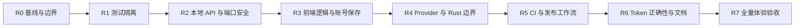

# Token Eyes 代码问题修复执行文档

> 用途：把本文件交给一个新的编码对话执行。执行者可以是任意 Agent，不限定 Codex、Cursor、Trae 或其他工具。
>
> 依据：`CLAUDE.md`、`docs/reports/2026-07-26-代码问题报告.md` 和当前工作区实际状态。
>
> 核心原则：自动测试通过只是必要条件，不是完成条件。每一批修复必须同时通过代码检查、自动测试、真实运行体验和跨功能回归。

## 一、可以直接复制给新对话的指令

```text
请读取仓库根目录 CLAUDE.md，以及
docs/reports/2026-07-26-代码问题修复执行文档.md。

严格从 R0 开始按顺序执行，不要跳阶段，不要一次性修改全部问题。
当前工作区可能包含用户未提交改动：禁止 git reset --hard、git checkout --、
clean、覆盖用户文件或擅自删除历史代码。

每完成一个阶段：
1. 对照该阶段验收清单逐项验证；
2. 运行该阶段测试、相邻功能回归、生产构建和真实运行冒烟；
3. 提供实际命令、退出码、通过/失败数量和脱敏后的体验证据；
4. 说明是否产生新回归；
5. 未满足任何一项时不得宣布完成，也不得进入下一阶段。

不要通过删除测试、放宽断言、加 skip、吞异常、返回假数据或恢复 CC Switch
旧功能来制造“测试通过”。发现计划与代码不符时，先完成影响分析，只调整当前
阶段的最小范围；不得未经说明推翻整份计划。
```

## 二、修复目标

修复完成后，应达到以下结果：

1. 恶意网页不能读取 Token Eyes 的本地 Token、成本、项目、请求或账号信息。
2. 指定端口被其他程序占用时，Token Eyes 不会结束该程序。
3. 测试不会读取真实用户目录、真实账号、真实 Token 队列，也不会访问真实供应商接口。
4. Node、Dashboard、TypeScript、ESLint、有效 Rust 测试和生产构建全部具有可靠门禁。
5. Kimi 两种账号类型保存、重启、刷新后仍对应正确凭据。
6. Provider 能力在 Node、Dashboard 和仍然发布的桌面端保持一致。
7. Token 去重和分项总和可被严格审计，异常会使检查失败。
8. 当前有效发布工作流、文档和实际桌面架构一致。
9. 真实安装/运行时的关键用户流程完成冒烟验证，不用“单元测试通过”替代用户体验。

## 三、明确不做

- 不新增多账号矩阵、Burn rate、导出等产品优化功能；它们属于后续优化文档。
- 不恢复模型切换、账号切换、代理、MCP、Skill 管理等 CC Switch 历史功能。
- 不为了让旧 Rust 测试编译而重新引入已经移除的旧依赖和旧命令。
- 不处理与本报告无关的界面重设计和大规模重构。
- 不发布、不推送、不创建正式 Release，除非用户另行明确授权。

## 四、为什么不能只看“测试通过”

本项目曾出现的典型误判是：

- 单测使用了模拟数据，但真实用户目录或真实凭据仍被读取。
- 一个页面测试通过，但完整页面缺少 Router、Context 或本地服务后崩溃。
- 某个问题被修复，却改变了未传参数和空数组的语义，导致另一处没有数据。
- 库测试通过，但完整 Rust 测试仍引用已经移除的 CC Switch。
- 构建成功，但本地 API 仍可被浏览器跨域窃取。

因此本修复采用四层验收：

| 层级 | 证明什么 | 不能替代什么 |
|---|---|---|
| 单元/契约测试 | 某个函数和接口满足明确契约 | 不能证明完整页面和真实进程可用 |
| 集成测试 | 多模块、路由、存储和认证能协同 | 不能证明打包后的桌面体验 |
| 生产构建/桌面运行 | 实际产物可启动、页面可操作 | 不能证明所有边界和历史数据正确 |
| 人工冒烟与数据核对 | 用户真实路径、显示和错误状态正确 | 不能替代可重复的自动回归 |

阶段完成必须同时具备这四层中与该阶段相关的证据。

## 五、全程执行纪律

### 5.1 保护当前工作区

执行前必须运行并保存结果：

```powershell
git status --short
git branch --show-current
git rev-parse HEAD
git diff --stat
git diff --name-status
```

规则：

- 当前已修改和未跟踪文件默认属于用户。
- 优先在独立分支或独立 worktree 中修复。
- 如果无法安全建立 worktree，先生成补丁备份和文件清单，再修改。
- 不得用 `git reset --hard`、`git checkout --`、`git clean` 清理现场。
- 每个提交只包含一个可解释的问题批次。

### 5.2 测试规则

- 修复缺陷前先写能复现缺陷的测试，并确认该测试在修复前确实失败。
- 修复后确认测试通过；必要时临时撤回修复，证明回归测试会重新失败。
- 不得删除、跳过或弱化失败测试，除非已经证明它测试的是废弃产品边界，并在报告中说明替代测试。
- 对时间、网络、HOME、端口、随机数使用可注入依赖或 fixture，不能依赖开发机环境。
- 测试输出中不得出现真实用户名、真实账号 ID、Cookie、Token、完整敏感路径或真实队列内容。

### 5.3 完成证据

每阶段建立：

```text
docs/test-reports/repair/Rx-<阶段名>-验收.md
```

至少记录：

- 开始和结束 commit；
- 修改文件；
- 新增/修改的测试；
- 执行命令、退出码、通过/失败数；
- 真实体验步骤和结果；
- 是否发现回归；
- 未解决事项；
- 回滚方法。

不接受“应该没问题”“测试基本通过”“只有无关失败”等模糊结论。

## 六、执行总览



所有阶段默认串行。原因是后面的判断依赖前面可信的测试环境和安全契约。

## 七、R0：冻结基线和当前产品边界

### 目标

先弄清哪些代码真正参与当前构建、哪些失败是现存问题、哪些改动属于用户，避免第一批修改后才发现修错产品。

### 必须检查

1. 完整阅读 `CLAUDE.md`。
2. 检查 `package.json`、`dashboard/package.json`、`src-tauri/Cargo.toml`、`src-tauri/tauri.conf.json`。
3. 检查当前工作区是否正在从旧原生壳迁移到 Tauri。
4. 检查 `.github/workflows` 是否缺失，并用 Git 历史定位最后可信版本。
5. 为每个测试失败建立分类：真实缺陷、测试环境污染、历史功能残留、工作流缺失、级联失败。

### 新鲜基线命令

```powershell
npm test
npm --prefix dashboard test
npm --prefix dashboard run typecheck
npm --prefix dashboard run lint
npm --prefix dashboard run build
cargo test --manifest-path src-tauri/Cargo.toml --lib
cargo test --manifest-path src-tauri/Cargo.toml
npm run validate:copy
npm run validate:ui-hardcode
npm run validate:guardrails
npm audit --json
```

Token 审计只允许对脱敏 fixture 运行严格模式；在 R1 完成前，不得再次读取真实队列来证明测试：

```powershell
node scripts/audit-token-correctness.cjs --strict --input test/fixtures/token-audit/queue.jsonl
```

如果脚本尚不支持这些参数，把它记录为 R6 的待实现契约，不要临时对真实 HOME 执行。

### 输出

`docs/test-reports/repair/R0-基线与产品边界.md`

报告必须包含一张“失败归属表”，每个失败只能有一个主要归属阶段。

### 阶段门

- 已记录当前未提交改动，确认没有覆盖它们。
- 已识别当前真正发布的桌面目标。
- 每个已知失败都能归入 R1–R6，不留“以后再看”的未知失败。
- 若当前架构与 `CLAUDE.md` 严重冲突，只暂停冲突项，不暂停能够独立完成的安全调查。

## 八、R1：彻底隔离测试环境

### 解决的问题

- P1-06：测试读取真实 HOME、AgentData、凭据和 Token 队列。
- 为后续所有阶段建立可信测试环境。

### 主要文件

- `test/helpers/home-shim.cjs`
- `src/lib/data-directories.js`
- `src/lib/subscriptions.js`
- `src/lib/usage-limits.js`
- `test/data-directories.test.js`
- `test/subscriptions.test.js`
- `test/usage-limits.test.js`
- `test/usage-limits-singleflight.test.js`
- `package.json`

### 固定契约

1. 被测函数一旦接收 `home`、`env`、`platform`，其深层调用不得重新读取真实 `process.env` 或 `os.homedir()`。
2. 测试默认使用临时 HOME 和空白敏感环境变量。
3. 单元测试默认禁止真实网络；需要网络行为时必须注入 fake fetch。
4. 测试 fixture 中只能出现显式虚构账号和路径。
5. 单个测试文件和全套测试的结果必须一致。

### TDD 任务

1. 增加回归测试：传入临时 HOME，但真实 `CODEX_HOME` 指向诱饵目录；结果不得包含诱饵数据。
2. 增加回归测试：未注入 fake fetch 时若尝试外网请求，测试立即失败。
3. 增加回归测试：日志和异常对象不包含完整 queue、Cookie 或账号 ID。
4. 修复路径解析和参数透传。
5. 将隔离 preload 接入统一测试命令，避免依靠某个测试文件手动 `require()`。

### 自动验证

```powershell
node --test test/data-directories.test.js
node --test test/subscriptions.test.js
node --test test/usage-limits.test.js
node --test test/usage-limits-singleflight.test.js
npm test
```

### 真实隔离验证

在测试前设置一个包含虚构敏感文件的诱饵目录，并监听是否发生外网请求。测试结束后：

- 诱饵账号不得出现在输出；
- 不得出现用户真实主目录；
- 网络监听不得发现供应商 API 请求；
- 临时目录外不得新增或修改 Token Eyes 数据。

### 阶段门

- 以上四个目标测试文件单独运行和全套运行结果一致。
- 全套测试日志不包含真实用户路径和账号。
- 后续阶段才允许把 Node 测试结果当成可信证据。

## 九、R2：本地 API、CORS、Host 和端口安全

### 解决的问题

- P1-01：任意网页可跨域读取本机使用数据。
- P1-02：指定端口时可能杀死无关进程。
- 为后续“本地只读 API”优化建立安全底座。

### 主要文件

- `src/lib/local-api.js`
- `src/commands/serve.js`
- `dashboard/src/lib/local-api-auth.ts`
- `dashboard/src/lib/local-api-url.ts`
- `test/local-api-security.test.js`
- `test/local-api-handshake.test.js`
- `test/serve-bind-host.test.js`
- `test/serve-port-hint.test.js`

### 安全契约

#### Host

只接受当前监听端口上的：

- `127.0.0.1`
- `localhost`
- IPv6 loopback（如果服务实际启用）
- Tauri 内部固定 Host（仅限真实运行需要）

拒绝公网域名、任意 Host 和 DNS rebinding Host。校验应正确处理端口。

#### Origin

- 普通响应不得返回 `Access-Control-Allow-Origin: *`。
- 只允许实际使用的 loopback Dashboard Origin 和 Tauri Origin。
- 允许 Origin 时动态回显，并返回 `Vary: Origin`。
- 恶意 Origin 的预检、认证握手、GET、POST 全部拒绝。
- 无 Origin 的本机 CLI 调用必须经过 Host 校验；敏感接口仍需要本地认证 Token。

#### 本地认证

- 敏感 GET 和所有写请求统一要求 `X-TokenTracker-Local-Auth`。
- `/api/local-auth` 只能被允许 Origin 或通过严格 Host 检查的无 Origin 本机客户端调用。
- 认证 Token 不写入 URL、错误信息、访问日志或导出文件。
- 401、403、404 的使用场景固定，不能泄漏资源是否存在。

### 端口契约

- 用户显式指定的端口被占用时，返回清晰错误并退出。
- 不得向未知 PID 发送 `SIGTERM` 或 `SIGKILL`。
- 如果保留旧实例复用，只能通过 Token Eyes 自己的健康检查和受验证的 PID 元数据。

### TDD 任务

1. 先增加恶意 Origin、恶意 Host、无 Token 敏感 GET 的失败测试。
2. 增加合法开发 Origin、Tauri Origin和无 Origin CLI 的成功测试。
3. 增加虚假/过期 Token 的失败测试。
4. 增加“其他程序占用端口仍存活”的子进程测试。
5. 最小化修改 CORS、Host、认证和端口处理。
6. 验证所有既有 Dashboard API 调用仍能完成握手。

### 自动验证

```powershell
node --test test/local-api-security.test.js
node --test test/local-api-handshake.test.js
node --test test/serve-bind-host.test.js
node --test test/serve-port-hint.test.js
npm test
npm --prefix dashboard test
npm --prefix dashboard run build
```

### 真实体验验证

1. 启动 `node bin/tracker.js serve --no-sync`。
2. 在正常 Dashboard 中打开仪表盘、成本、设置、额度和请求明细。
3. 从另一网页 Origin 发起 fetch，确认浏览器无法读取响应。
4. 用无认证 curl 请求敏感接口，确认失败。
5. 用合法本地握手取得 Token 后请求，确认成功。
6. 启动一个虚构 HTTP 服务占用测试端口，再启动 Token Eyes；确认虚构服务仍存活。
7. 检查控制台无认证 Token、Cookie、完整敏感路径。

### 阶段门

- 安全测试和真实浏览器验证都通过。
- Dashboard 没有因为加认证出现空白页或无限 401。
- 端口冲突不会结束无关进程。
- 不得以“只绑定 loopback”为理由跳过 CORS 和 Host 检查。

## 十、R3：修复前端类型、路由依赖、过滤语义和 Kimi 保存

### 解决的问题

- P1-04：TypeScript 错误。
- P1-05/P2-07：Kimi 不可达分支和 Lint 错误。
- P2-02：Spend 页面测试缺少 Router。
- P2-03：`visibleProviderIds` 三态错误。

### 主要文件

- `dashboard/src/hooks/use-request-usage-records.ts`
- `dashboard/src/hooks/__tests__/use-request-usage-records.test.tsx`
- `dashboard/src/lib/native-bridge.js` 或对应 `.d.ts`
- `dashboard/src/pages/SpendPage.test.jsx`
- `dashboard/src/ui/dashboard/components/TokenServiceListPanel.jsx`
- `dashboard/src/components/settings/TokenPlanSection.jsx`
- `dashboard/src/components/settings/TokenPlanSection.test.jsx`

### 固定契约

`visibleProviderIds` 必须保留三态：

| 输入 | 含义 |
|---|---|
| `undefined` | 不增加 Provider 可见性过滤 |
| `[]` | 用户明确隐藏全部，直接返回空且不发请求 |
| 非空数组 | 与其他筛选条件求交集 |

Kimi 保存必须区分：

| 类型 | 保存内容 |
|---|---|
| `kimi_api_budget` | `api_key_ref`，不写控制台 session ID |
| Kimi Code 官方套餐 | `account_binding_id` 和正确 Provider 首页 |

### TDD 任务

1. 为 `visibleProviderIds` 三种输入分别写请求参数和“不发请求”测试。
2. 为页面统一测试渲染器补齐 Router、Theme、Locale 和筛选 Context。
3. 为 Kimi 两种模式分别写“保存—重新加载—刷新”测试。
4. 修复类型声明，不用宽泛 `any` 掩盖桥接接口。
5. 修复重复 Kimi 条件和多余布尔转换。

### 自动验证

```powershell
npm --prefix dashboard test -- src/hooks/__tests__/use-request-usage-records.test.tsx
npm --prefix dashboard test -- src/pages/SpendPage.test.jsx
npm --prefix dashboard test -- src/components/settings/TokenPlanSection.test.jsx
npm --prefix dashboard run typecheck
npm --prefix dashboard run lint
npm --prefix dashboard test
npm --prefix dashboard run build
```

### 真实体验验证

- 未设置 Provider 过滤时，请求明细仍显示全部允许来源。
- 隐藏全部 Provider 时，页面显示明确空状态且无后台请求风暴。
- 点击空套餐引导可正确进入 `/settings/cost`。
- Kimi Code 和 Kimi API Budget 各保存一次，重开设置后字段不串位，刷新仍成功。
- 浏览器控制台无未处理 React 异常。

### 阶段门

- TypeScript 和 ESLint 均为 0 错误。
- Vitest 不存在未处理异常。
- 真实页面操作与测试语义一致。

## 十一、R4：统一 Provider 能力并清理 Rust 有效测试边界

### 解决的问题

- P2-01：Node、Dashboard、macOS/Windows/Tauri Provider 列表不一致。
- P2-04：完整 Rust 测试仍指向 CC Switch 历史能力。

### 先冻结能力概念

不得再用一个“supported providers”数组表达所有能力。至少区分：

```json
{
  "token_usage_collection": true,
  "official_rate_limit": false,
  "manual_token_plan": true,
  "provider_balance": false,
  "desktop_visibility": true
}
```

建议建立唯一、可校验的机器可读清单，例如：

```text
shared/provider-capabilities.json
```

Node 和 Dashboard 直接读取或构建时生成；Swift/C# 若仍是发布目标，则由脚本生成常量并通过 parity 测试校验。不要维护多个手写“全量 Provider”数组。

### Trae 决策

必须根据真实适配器能力标记：

- 已支持本地 Token 采集；
- 是否支持官方额度查询；
- 是否只支持手动套餐；
- 哪些桌面端应显示。

没有真实官方额度适配器时，不得仅为通过列表测试而声明支持。

### Rust 测试处理

1. 列出 `src-tauri/src/lib.rs` 当前编译模块和 Tauri 命令。
2. 逐个检查 `src-tauri/tests/*.rs` 是否验证当前模块。
3. 引用 `cc_switch_lib`、代理、切换、MCP、Skill 等废弃能力的测试不得重新接回当前产品。
4. 历史测试可由 Git 历史保留；移出当前测试目标时，必须在验收报告列出文件和原因。
5. 为当前托盘、窗口、单实例、本地服务、官方会话桥补充有效集成测试。

### 自动验证

```powershell
node --test test/agent-adapters.test.js
node --test test/limits-providers-parity.test.js
npm --prefix dashboard test -- src/hooks/use-limits-display-prefs.test.js
cargo test --manifest-path src-tauri/Cargo.toml --lib
cargo test --manifest-path src-tauri/Cargo.toml
npm test
npm --prefix dashboard test
```

如果旧原生 macOS/Windows 壳仍属于当前发布目标，还必须运行对应原生测试；若不属于，必须在 R0 的发布目标记录中有明确证据。

### 真实体验验证

- 同一 Provider 在采集、额度、手动套餐和桌面显示中的能力描述一致。
- Trae 没有被错误展示为可查官方额度。
- 隐藏和排序设置在重启后保持。
- Tauri 中当前有效的会话连接、托盘和窗口行为可正常使用。

### 阶段门

- `cargo test` 不再因 CC Switch 历史测试无法编译。
- 不通过恢复旧依赖或旧产品功能达成绿灯。
- Provider parity 测试来自同一能力清单。

## 十二、R5：恢复可信 CI 和发布工作流

### 解决的问题

- P1-03：`.github/workflows` 缺失。
- P2-08：`ci:local` 未覆盖 Dashboard 测试、类型、Lint 和 Rust。

### 历史证据

Git 历史中的 `d1d14f75`、`1a364329`、`b307c49e`、`2054ae83` 等提交包含：

- `.github/workflows/npm-publish.yml`
- `.github/workflows/release-dmg.yml`
- `.github/workflows/release-windows.yml`

这些文件只能作为恢复参考，不能不审查就复制。当前 `src-tauri/tauri.conf.json` 已存在 Tauri 打包配置，必须先与 R0 确认的发布目标对齐。

### 实施顺序

1. 从最后可信提交提取 workflow 内容进行只读比较。
2. 对照当前版本号位置、Tauri/旧壳、签名、公证、npm 和 Homebrew 流程。
3. 恢复或重写最小有效工作流。
4. 更新契约测试，使它验证当前发布目标，而不是历史架构。
5. 扩充 `ci:local`，覆盖：
   - Node；
   - Dashboard typecheck、lint、Vitest、build；
   - Rust 当前库和集成测试；
   - 文案/架构校验；
   - fixture 上的严格 Token 审计。

### 自动验证

```powershell
node --test test/npm-publish-workflow.test.js
node --test test/release-dmg-workflow.test.js
node --test test/release-windows-workflow.test.js
npm run ci:local
```

如果工作流支持本地语法校验或 dry-run，一并执行。不得触发真实发布。

### 阶段门

- 工作流契约测试验证的是当前产品。
- `ci:local` 的任何子命令失败都会使总命令非零退出。
- 本地 CI 不读取真实用户数据。
- 没有触发发布、上传或修改外部仓库。

## 十三、R6：Token 严格审计、README 和产品边界

### 解决的问题

- P2-05：重复 bucket 和 Token 分项异常未使审计失败。
- P2-06：README 的数量、路由、网络和桌面架构与实际不符。
- P3 中与本轮修改直接相关的噪声。

### Token 契约

继续遵守 `CLAUDE.md`：

```text
total_tokens =
  input_tokens
  + output_tokens
  + cached_input_tokens
  + cache_creation_input_tokens
  + reasoning_output_tokens
```

如果供应商给出的总量包含无法归类的 Token，应显式设计 `other_tokens` 或保存供应商原始总量；不得静默制造差值，也不得把差值随意塞入输入或输出。

### 审计任务

1. 为“允许的同 bucket 增量快照”和“真正重复事件”定义不同 key。
2. 给 `scripts/audit-token-correctness.cjs` 增加 `--strict` 和 `--input`。
3. strict 模式发现不变量、真实重复或无效负数时必须非零退出。
4. 增加脱敏 fixture：正常、允许快照、重复事件、分项不等、边界大整数。
5. 用本地 API 聚合结果与 fixture 原始重算做 golden 对比。
6. 连续执行两次同步，确认第二次不会重复累计。

### README 任务

- Provider 数量从能力注册表生成或经测试校验。
- 明确区分：
  - 当前可见功能；
  - 已实现但被 MVP 隐藏的功能；
  - 可选云功能；
  - 历史旧壳；
  - 会访问网络的额度、定价、汇率和云同步。
- 排行榜必须写入功能说明，同时准确标注当前是否开放。
- 不把本地优先写成“绝不发生任何网络请求”。

### 自动验证

```powershell
node --test test/token-audit.test.js
node scripts/audit-token-correctness.cjs --strict --input test/fixtures/token-audit/queue.jsonl
npm run validate:copy
npm run validate:ui-hardcode
npm run validate:guardrails
npm run ci:local
```

### 阶段门

- 错误 fixture 必须让 strict 审计失败，正确 fixture 必须通过。
- 二次同步 Token 总量不增长，除非 fixture 新增了事件。
- README、路由和实际构建一致。

## 十四、R7：最终全量回归和真实体验验收

R7 不再新增修复，只验证已经完成的工作。发现问题时回到对应阶段修复并重新执行受影响的后续验收。

### 14.1 全量自动门禁

```powershell
npm run ci:local
npm test
npm --prefix dashboard run typecheck
npm --prefix dashboard run lint
npm --prefix dashboard test
npm --prefix dashboard run build
cargo test --manifest-path src-tauri/Cargo.toml
npm audit --json
```

要求记录每个命令的退出码和测试数量。任何失败都不能写成“总体通过”。

### 14.2 用户体验场景

| 场景 | 操作 | 预期 |
|---|---|---|
| 首次启动 | 空 HOME、无账号启动 | 有明确空状态，不崩溃、不读取外部目录 |
| 本地已有数据 | 打开仪表盘/使用量/成本 | 总量一致，筛选联动，无无限加载 |
| Provider 全隐藏 | 隐藏所有 Provider | 明确空状态，不错误请求全部 |
| Provider 未设置过滤 | 正常进入请求明细 | 显示全部允许来源 |
| Kimi Code | 保存、重开、刷新 | 账号绑定保持 |
| Kimi API Budget | 保存、重开、刷新 | API 引用保持且不串入 session |
| 恶意网页 | 跨 Origin 读取 API | 被拒绝且不能读取响应 |
| 端口占用 | 其他程序占用端口 | Token Eyes 报错，其他程序存活 |
| 离线 | 断网打开应用 | 本地数据可用；远程额度显示缓存/过期/错误 |
| 损坏缓存 | 使用损坏 fixture 启动 | 有可理解错误，不覆盖有效历史 |
| Tauri 桌面 | 启动、托盘、显示/隐藏、退出 | 无重复实例、无僵尸本地服务 |
| 排行榜入口 | 按当前产品决定访问 | 可用或明确隐藏，README 与行为一致 |

### 14.3 数据交叉核对

使用同一份脱敏 fixture，比较：

1. 原始事件重算；
2. queue 最新快照；
3. 本地 API 汇总；
4. Dashboard 总览；
5. Provider/模型/项目分组之和。

所有层级必须满足：

```text
分组之和 = 当前筛选条件下的总览
```

由于四舍五入造成的金额差异必须有固定容差；Token 数量不允许容差。

### 14.4 最终独立复审

由未参与主要实现的新上下文执行只读复审：

- 检查 diff 是否超出本报告；
- 检查是否删测试、加 skip、吞错误或硬编码假数据；
- 检查安全边界；
- 检查 Token 不变量；
- 检查真实体验证据；
- 随机复跑至少一个安全测试、一个 Dashboard 测试、一个 Rust 测试和生产构建。

## 十五、完成定义

只有同时满足以下条件，才能向用户报告“代码问题修复完成”：

- [ ] R0–R7 都有验收报告。
- [ ] 全量命令均为最新运行结果，退出码为 0。
- [ ] 没有未处理异常和意外网络访问。
- [ ] 恶意 Origin、恶意 Host、无认证 GET 均被拒绝。
- [ ] 端口占用不会结束无关进程。
- [ ] 测试不读取真实 HOME、账号或 Token 数据。
- [ ] Kimi 两种模式完成真实保存—重载—刷新。
- [ ] Provider 能力和有效 Rust 测试边界一致。
- [ ] Token strict 审计能对错误 fixture 非零退出。
- [ ] 生产构建和 Tauri 真实冒烟完成。
- [ ] 未覆盖用户原有改动。
- [ ] 最终报告列出仍存在的限制，不隐藏失败。

## 十六、遇到意外时的处理规则

### 可以在当前阶段自行修正

- 文件行号变化，但职责和接口未变。
- 测试名称变化，但存在等价测试。
- 小范围级联类型错误。
- 为可测试性增加依赖注入。

### 必须停止当前阶段并做影响分析

- 发现当前发布目标与 `CLAUDE.md` 完全相反。
- 安全修复需要改变所有客户端认证协议。
- Token 数据格式需要不可逆迁移。
- 需要删除或覆盖用户当前改动。
- 需要操作外部服务、凭据、发布或其他仓库。

影响分析只需要回答：

1. 原计划假设是什么；
2. 新证据是什么；
3. 哪些阶段受影响；
4. 最小兼容调整是什么；
5. 如何回滚。

禁止因为一个文件或一个测试不符合预期，就直接推翻全部阶段。
